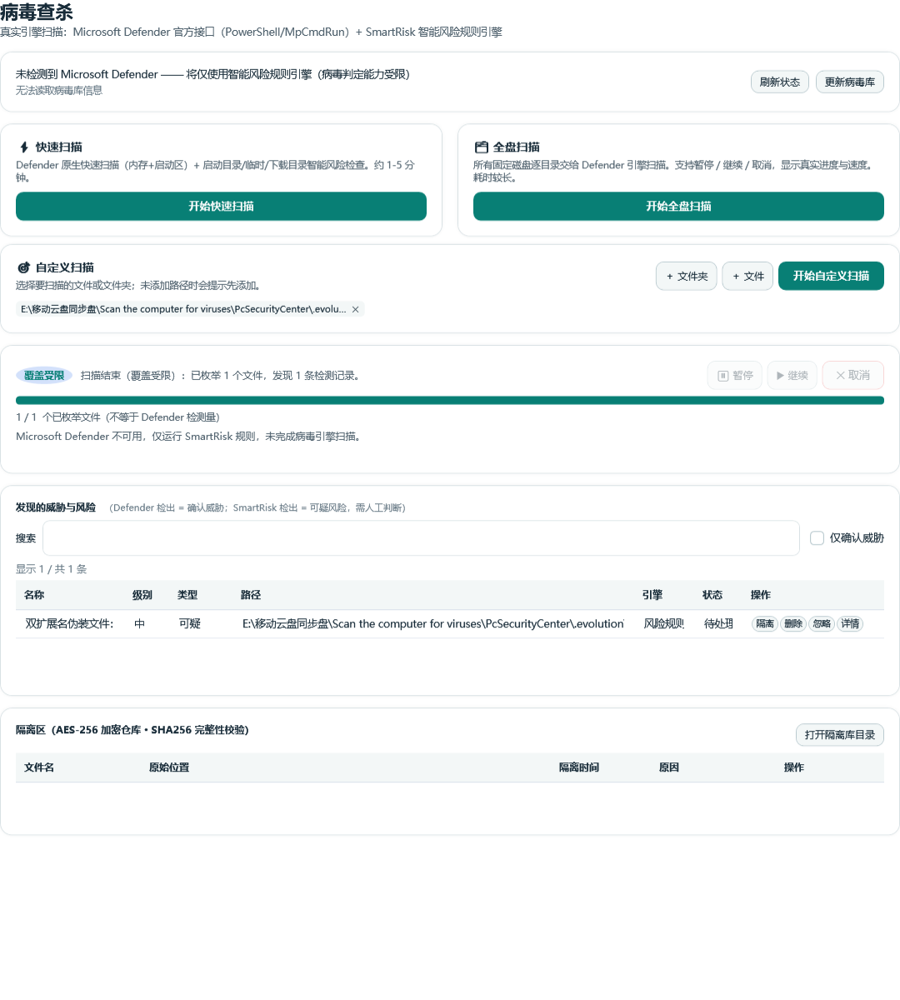
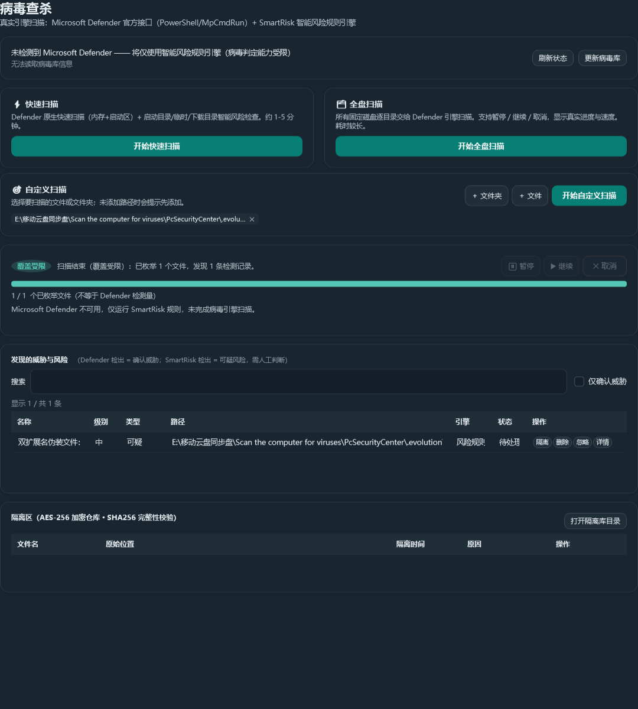

# 2026-11-13 本地进化升级报告

> 以下保留本地升级结束时的审查快照。后续发布版本为 [v1.2.4](https://github.com/yuchen0x1/Scan-the-computer-for-viruses/releases/tag/v1.2.4)，发布前的产物检查见 [暴露面审计](releases/v1.2.4-exposure-audit.md)。发行结果以 GitHub 发布页为准。

## 交付边界与进度

项目：Windows 智能安全卫士 / PC Security Center。实际 Git 根目录为当前工作目录下的 `PcSecurityCenter`，基线 `main` / `58d2210`（v1.2.3）。本地跟踪状态与 origin/main 对齐；没有远程 fetch，因此不据此判断远端此刻状态。起始唯一未跟踪内容为 `.evolution/research_sources/`，已保留，没有覆盖。未提交、推送、打标签或发布；没有修改正式配置、数据库或用户隔离库。

- [x] 核实项目、技术栈、入口与本地 SDK。
- [x] 审查关键扫描、Defender、隔离、配置、仓储、报告、页面与构建流程。
- [x] 联网核验 5 个相关开源项目的核心源码、许可证和维护活动。
- [x] 实施本轮 P0/P1 修复与直接相关 P2 体验改进。
- [x] 专项测试、安全回归、WPF 页面与自包含发布构建。
- [x] 同步 README、发布历史、验证说明与本报告。
- [ ] 完整应用启动、真机 Defender / UAC / 安装与更新端到端：尚未执行，不能作为通过。

审计是以高风险主链路为中心的源码审查，不是对全部操作系统适配与每个页面的穷尽证明。

## 1. 项目功能地图与主要问题

.NET 10 / C# / WPF / CommunityToolkit.Mvvm，Windows 10 build 19041+ x64，4 个生产项目、1 个测试项目；持久化为 SQLite WAL 与 JSON。入口 `App.xaml.cs`，原生 WPF、托盘、单实例、依赖注入；没有 Web 服务端、移动端或远程数据库。

| 层 | 真实能力 | 本轮核验重点 |
|---|---|---|
| Core | SmartRisk、扫描编排、范围枚举、PE/哈希分析、安全评分、HTML 报告 | 多引擎计数、去重、任务生命周期、取消和覆盖说明 |
| Platform | Defender/PowerShell、隔离加密与 DPAPI、性能/网络/注册表/维护/系统检查 | 官方接口语义、子进程输出、隔离读改写 |
| Data | SQLite 扫描/威胁/事件/维护/检查仓储、JSON 配置 | 结果关联、配置并发写入、失败保存 |
| App | 驾驶舱、扫描、保护、网络、安全、性能、维护、启动项、软件、工具、文件、报告、设置、更新共 14 页 | ScanViewModel 全链路，其他页面忙碌绑定静态核查 |
| 发布 | CI、publish.ps1、Inno Setup、静态更新清单/Atom/REST、多级更新校验 | 现有结构确认、自包含编译；不执行远程发布 |

无 TODO/FIXME 空实现命中；受限流的 NotSupportedException 是有意禁止 seek/write 的 Stream 契约，不作为虚假功能。存在的问题主要是已实现逻辑之间的连接错误：扫描计数叠加、共享 HashSet 并发使用、路径级去重掩盖确认威胁、跨扫描 UI 去重不清空、完成后的异步二次采集与写库脱节、失败仍记成功扫描时间、无效 WPF 反向绑定、配置截断写和隔离索引读改写竞态。

## 2. 开源研究与采纳

以下读取均通过 GitHub 连接器完成，只借鉴设计原则，没有复制第三方代码或添加依赖。维护时间是本次 API 返回的默认分支最近提交时间（UTC），不是发布日期。

| 项目与许可证 | 阅读的核心源码 | 最近提交 | 设计与应用 |
|---|---|---|---|
| [ClamAV](https://github.com/Cisco-Talos/clamav)，源文件 GPL-2.0 | [clamscan/clamscan.c](https://github.com/Cisco-Talos/clamav/blob/14915a94cf00ca3a3b7d93b4da050b4dc7f7b76a/clamscan/clamscan.c)：扫描摘要区分文件、检出和错误 | 2026-11-06 | 明确区分执行结束、检测结果和覆盖限制；用于扫描摘要与报告，不集成其引擎 |
| [BleachBit](https://github.com/bleachbit/bleachbit)，GPL-3.0-or-later | [Worker.py](https://github.com/bleachbit/bleachbit/blob/master/bleachbit/Worker.py)：预览/实际执行开关、取消、错误计数 | 2026-11-12 | 保留用户确认和可见错误；不把失败处理从列表中移除 |
| [SophiApp](https://github.com/Sophia-Community/SophiApp)，MIT | [SettingsService.cs](https://github.com/Sophia-Community/SophiApp/blob/a774d3ade4fe291852b008ad47f6cefdfa329a7e/src/Services/SettingsService.cs)：配置服务、窗口尺寸、文本大小与主题 | 2026-11-09 | 保持本项目原生 WPF 及主题体系，强化设置持久化；未宣称上游采用同样原子保存实现 |
| [System Informer](https://github.com/winsiderss/systeminformer)，MIT | [ToolStatus/filter.c](https://github.com/winsiderss/systeminformer/blob/8b1825d3fae4830f1aada623ef085f818df6e6da/plugins/ToolStatus/filter.c)：名称、路径、命令行与发布者等多字段筛选 | 2026-11-12 | 威胁列表按名称、路径、引擎、依据搜索；过滤不修改底层检测记录 |
| [Bulk Crap Uninstaller](https://github.com/BCUninstaller/Bulk-Crap-Uninstaller)，Apache-2.0 | [AdvancedFilters.cs](https://github.com/BCUninstaller/Bulk-Crap-Uninstaller/blob/30da609384c98ba6e35c6530129541ea4ff3970a/source/BulkCrapUninstaller/Controls/Settings/AdvancedFilters.cs)：筛选事件、未保存状态与错误提示 | 2026-09-07 | 独立视图筛选、确认威胁过滤与保存失败反馈；不照搬批量卸载 |

ClamAV 属同领域扫描引擎，其余为系统清理、Windows 设置、系统观察与软件管理等相邻领域。GPL 源码未移植到本项目 MIT 代码；MIT/Apache 项目同样只参考行为，未复制资源。

| 维度 | 原有项目 | 参考优秀实践 | 本次改进/保留边界 |
|---|---|---|---|
| 核心功能 | 两个引擎但计数混合、失败可被覆盖 | ClamAV 独立错误摘要 | 单一枚举计数、按引擎与检测身份去重、持续覆盖说明 |
| UI | 原生卡片与表格，标签截断 | SophiApp 原生设置与主题 | 中文标签、主按钮对比、明暗主题截图 |
| 用户体验 | 缺少告警搜索，旧去重导致结果消失 | System Informer / BCU 筛选 | 真实集合视图过滤、结果总数、重复扫描正常 |
| 技术架构 | MVVM 四层、后台工作但收尾失序 | 上游 worker / service 分层 | 保留架构，等待结果持久化再解除界面锁 |
| 自动化 | 已有 CI 与发布脚本 | 可取消 worker 与错误可见 | 新增安全测试和 WPF 验证入口，不新增后台自动删除 |
| 扩展性 | 已有 IScanEngine | 引擎与展示分离 | 扩展进度快照字段，不换框架/数据库/杀毒引擎 |

## 3. 本次成果与优先级

### P0 / P1 已落地

1. 根路径规范化并去除重叠；修复磁盘根路径包含判断；枚举根本身也是重解析点时跳过。文件量由 SmartRisk 的枚举批次独立累计，避免 Defender 再次加总；不虚称为引擎内部精确检测数。
2. 检测身份包含引擎、路径、ThreatID、名称，在锁内去重并串行通知；同文件确认威胁不会被规则提示吞掉。
3. 消费者提前退出时取消并等待目录生产者，避免有界通道写满后无限挂起；估算任务统一观察并在退出前结束，减少旧任务污染下一次扫描。
4. Defender 不可用/失败/提前退出的警告不被完成消息抹去。空路径直接失败，失效的部分路径有提示。范围和覆盖信息保留到 SQLite、HTML/PDF。
5. 移除跨扫描 UI 去重与完成后再次拼入 Defender 历史的逻辑。收齐本次检测写库任务后保存汇总，再允许下一次扫描；保存异常明确显示。扫描与落库期间禁用威胁处理，避免处理状态与尚未写入的检测相互竞争。仅无覆盖警告的 Completed 更新成功扫描时间。
6. **纠正官方接口误用**：[Microsoft Remove-MpThreat 文档](https://learn.microsoft.com/en-us/powershell/module/defender/remove-mpthreat?view=windowsserver2025-ps)列出的命令会移除全部活动威胁，没有 ThreatID 参数。旧接口保留返回 false，UI 引导 Windows 安全中心，活动记录不被移除。历史文档中的“按 ID 定点处理”描述由本说明更正。
7. MpCmdRun 同时排空 stdout/stderr，并限制输出尾部缓存为 64 KiB；批量路径任一路径失败不能被后续成功覆盖。
8. 配置同实例串行保存，先写同目录独立临时文件再原子替换；写失败保留原文件。隔离/恢复/删除同实例串行化，避免索引更新丢失；索引不可读时拒绝继续写；恢复目标禁止覆盖，解密失败清理临时明文。

### P2 已落地

告警搜索、确认威胁过滤、显示数/总数；中文级别/类型/状态；可用性绑定与暂停/继续/取消命令状态；覆盖受限状态直达界面；主按钮白字；其他 7 个页面无效的 `Binding !IsBusy/!IsChecking` 改为现有 InverseBool 转换器。

未做无关重写，没有新增生产依赖、数据迁移或服务。数据库表结构未变化，旧记录仍按原字段读取。

## 4. 文件清单

| 文件 | 目的 |
|---|---|
| `Core/Scanning/ScanOrchestrator.cs`、`FileEnumerator.cs` | 路径、计数、并发、终止与覆盖说明 |
| `Core/Models/ThreatModels.cs`、`Core/Abstractions/IScanAbstractions.cs` | 新增进度说明字段；纠正接口契约 |
| `Platform/Defender/DefenderClient.cs` | 拒绝无效单条清除，输出读取、失败汇总、时间归因 |
| `Platform/Security/QuarantineService.cs` | 串行操作与恢复防覆盖、失败清理 |
| `Data/Configuration/ConfigService.cs` | 原子保存及失败保护 |
| `App/ViewModels/ScanViewModel.cs`、`App/Views/ScanPage.xaml` | 告警/持久化顺序、可用性、过滤、覆盖提示 |
| `App/Services/Converters.cs`、`App/Themes/Controls.xaml` | 中文状态标签、主按钮对比 |
| `App/Views/{Dashboard,FileAnalysis,Maintenance,ReportCenter,Software,Startup,SystemSecurity}Page.xaml` | 修复反向 bool 绑定 |
| `Core/Reporting/ReportData.cs`、`App/Services/PdfReportExporter.cs` | 导出真实枚举口径与每次扫描覆盖限制 |
| `tests/.../ScanReliabilityTests.cs`、`CoreLogicTests.cs` | 13 个新增专项回归、报告限制转义断言 |
| `tools/PcSecurityCenter.UiSmoke/` | 可重复运行的 Windows WPF 验证工具与说明 |
| `README.md`、`docs/releases/release-notes.md`、`installer/更新日志.md` | 未发布变更与能力说明同步 |

上述 Core/Platform/Data/App 路径均位于 `src/PcSecurityCenter.*`。无源码或用户文件删除。

## 5. 验证结果与复现

| 状态 | 检查 | 证据/边界 |
|---|---|---|
| PASS | `dotnet build PcSecurityCenter.slnx -c Release --nologo` | 0 警告、0 错误；`.evolution/verification/build-final.log` |
| PASS | 13 项新增扫描/配置/隔离专项测试 | `scan-reliability.trx`：重复根、两引擎、失败/不可用、空范围、重复运行、早退、取消/并发、配置原子写、隔离并发等 |
| PASS | 安全回归 113/113，0 失败、0 跳过 | `regression-final.trx`；包含 13 项专项，不重复相加 |
| PASS | WPF 验证工具 | 真实页面、扫描编排/SmartRisk、SQLite；离线 Defender 替身，明暗渲染、无绑定告警；`ui-acceptance.log`，见工具 README |
| PASS | Windows x64 self-contained publish | `.evolution/verification/publish/`；可分发目录编译成功，不等于安装签名/运行验收 |
| PASS | NuGet 已知漏洞查询 | `dependency-audit.json`；当时 NuGet 源未报告已知漏洞，不代表无未知漏洞 |
| PASS | `git diff --check` | 无空白格式错误 |
| PARTIAL | UI/UX | 扫描页 1080×1200、96 DPI；其他页面反向绑定仅静态核查与编译，未逐页操作；无多 DPI/读屏测试 |
| PARTIAL | 全测试集合 | 明确排除 7 项调用真实 Defender/整机系统检查的测试，未将其标为跳过或通过 |
| PARTIAL | 数据一致性 | 新建隔离 SQLite 的扫描/威胁关联通过；没有对正式用户数据库做升级或恢复 |
| BLOCKED | 真实签名更新验收 | 现有更新文档说明尚无代码签名证书；本次未新增证书、发布或验证老客户端安装新版本 |
| NOT APPLICABLE | Web/API/移动端检查 | 本项目是本地 WPF 应用 |

回归过滤器与 WPF 命令见 `tools/PcSecurityCenter.UiSmoke/README.md`。发布命令：

```powershell
dotnet publish src/PcSecurityCenter.App -c Release -r win-x64 --self-contained true -p:PublishSingleFile=false -o .evolution/verification/publish
```

开发过程中一次构建曾因包装 DeleteAsync 重名失败，已修正后重跑通过。最终没有已知失败测试；没有把未执行的实际安装、整机扫描、全页面交互列为通过。

## 6. 后续任务（按优先级）

- P1：专用测试机执行真实 Defender 自定义/快速/全盘、服务状态变化、权限拒绝、取消与暂停语义验收。系统 Defender 服务与控制进程的生命周期不同，终止控制进程不保证系统扫描即时停止；已排队目录可能继续执行。
- P1：隔离库进程崩溃/断电一致性，以及原文件被其他进程替换时的文件句柄级保护；本轮同实例串行化不宣称解决跨进程或断电事务。
- P1：检测记录接口目前仍有尽力读取/吞错路径，需要进一步改成结构化错误；SmartRisk 跳过的访问失败也需要可审计计数。当前枚举量不能解释成完整病毒覆盖。
- P1：Windows 10/11 专用测试机安装、主程序启动、签名发布与跨版本更新全流程。
- P2：全页面窄窗口、多 DPI、键盘/读屏验收；大量告警性能基准、查询分页。保留当前筛选，后续再引入高级检索。
- P3：持久化扫描作业与可恢复任务模型、引擎结果结构化诊断。暂不引入新引擎、云信誉上传或自动破坏性修复。

## 7. 完成度（证据等级 0–5，不是市场评分）

口径：0 未有实现；1 仅方案；2 已实现/静态审查；3 本地自动化通过；4 真机完整流程通过；5 持续生产证据。

| 维度 | 等级 | 依据及限制 |
|---|---:|---|
| 功能完整度 | 3 | 关键扫描链路与数据关联通过；真实 Defender 与主程序启动待验 |
| UI/UX | 3 | 扫描页实际 WPF 明暗渲染与筛选通过；其余页面未全验 |
| 代码质量 | 3 | 零警告构建、回归覆盖本轮缺陷；未做穷尽审计 |
| 性能 | 2 | 去掉双计数/重复自定义枚举、限制输出缓存；没有大型磁盘基准 |
| 安全性 | 2 | 官方接口纠错与失败保护已验证，但签名/断电/并发外部进程仍未完成 |
| 稳定性 | 3 | 取消、早退、重复运行、并发保存回归通过；缺少长时间压力测试 |
| 可维护性 | 3 | 沿用四层架构，补充可重复验证工具、明确口径和文档 |
| 扩展性 | 2 | 保留引擎接口与兼容字段；未用第三方引擎做集成证明 |

本批完成本地可审查实现及列明的验证。上述待验项仍然开放，不能把本报告理解为整机防护、全部页面或正式发行的全面验收。

## 附：实际 WPF 渲染截图

使用离线 Defender 替身和无害双扩展名测试文件，展示覆盖受限状态，不代表本机杀毒结果。




